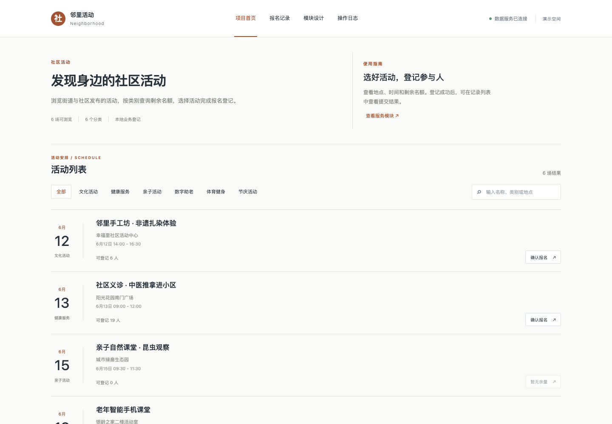

# 基于 Vue3 的街道社区活动报名管理系统的设计与实现

项目主题：街道社区活动报名管理系统（计算机毕业设计演示）。

## 技术栈

- 当前演示：Vue 3、Python、SQLite。
- 选题方案：Vue 3、Spring Boot、SQLite（部分技术尚未接入）。

## 项目功能

支持活动列表浏览、分类筛选、关键词搜索和确认报名，登记数据保存在本地数据库。

完整方案规划包括：活动发布与审核、在线报名与候补、名额实时管控、扫码签到核销、居民档案管理、消息通知中心、活动数据看板、权限与操作日志。部分功能尚待开发。

## 运行方式

在项目目录运行 `python3 backend/server.py`，然后访问 http://127.0.0.1:8000。

## 页面展示

## 微信联系

如果需要毕业设计，请扫描下方微信二维码联系。

